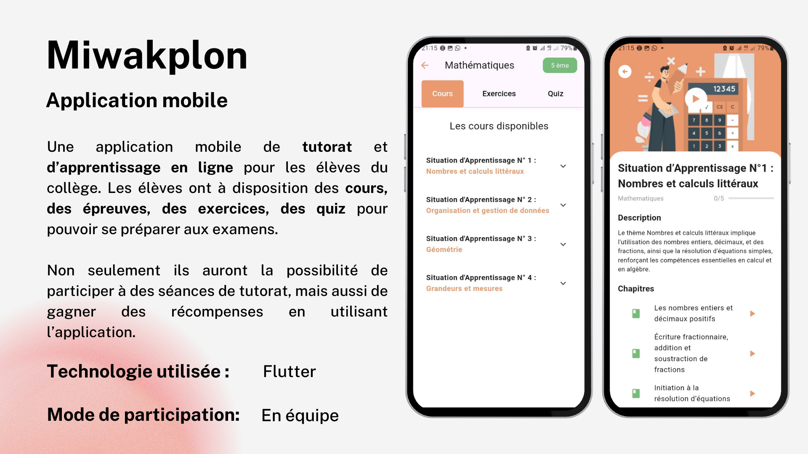

# Miwakplon

A mobile tutoring and online learning application for middle school students. Students have access to : 
- Lessons,
- Exams,
- Exercises,
- Quizzes

All of that to help them prepare for their exams. Not only can they participate in tutoring sessions, but they can also earn rewards by using the application.

You can download the .apk by checking the releases of this repository !

🚫 Ce projet est propriétaire. Aucune utilisation, copie ou distribution n'est autorisée sans permission explicite.
